# ДЗ №4 — отказоустойчивость с Apache ZooKeeper (вариант 1: Программист, разработчик на 1С)

Ансамбль из трёх серверов ZooKeeper 3.9.6 (Docker) и координатор расчёта сочетаний навыков из
[ДЗ 3](https://github.com/Stalnoy-gigant/de-hw3-rustfs-mapreduce) с выбором лидера, чекпоинтами
и защитой публикации результата по эпохе.

**Отчёт: [`report/report.pdf`](report/report.pdf)** (собирается командой `.venv/bin/python src/build_report.py`).

## Состав репозитория

| Путь | Что это |
|---|---|
| `compose.yaml` | три сервера `zk1..zk3`, образ `zookeeper:3.9.6` (внутри Java 17), запуск `zkServer.sh start-foreground` |
| `zk/zkN/conf/zoo.cfg` | конфигурации серверов: одинаковые строки `server.N`, свои `clientPort` (2181/2182/2183), порты кворума/выборов и `dataDir` |
| `zk/zkN/data/myid` | номер сервера (1, 2, 3) |
| `stage2.sh` | этап 2: роли, потеря одного и двух серверов, эфемерный узел |
| `src/coordinator.py` | координатор: выборы лидера, эпоха, чекпоинты, публикация результата (`FENCING=1` — с проверкой эпохи) |
| `src/scenario.py` | этапы 3–4: две копии координатора, `kill -STOP` лидера посреди расчёта, `kill -CONT` через 40 с |
| `logs/` | журналы координаторов (`<прогон>_A.log`, `<прогон>_B.log`) и сценария (`<прогон>_scenario.log`) |
| `outputs/` | выводы команд текстом: `stage2.txt`, `stage2_window2.txt`, `zk_pointers.txt` |
| `report/screens/` | скриншоты терминала по всем этапам |
| `report/report.pdf`, `report/img/` | отчёт и графики хронологии прогонов |

## Запуск

```bash
docker compose up -d                       # ансамбль ZooKeeper
(cd ../hw3 && docker compose up -d)        # RustFS из ДЗ 3 с данными s3://hh-lake/clean/vacancies.jsonl
python3 -m venv .venv && .venv/bin/pip install -r requirements.txt
./stage2.sh                                # этап 2 -> outputs/stage2.txt
.venv/bin/python src/scenario.py nofence             # этап 3, FENCING=0
.venv/bin/python src/scenario.py fence --fencing     # этап 4, FENCING=1
```

## Этап 1. Установка

Java на машине нет, поэтому выбран вариант с Docker: официальный образ `zookeeper:3.9.6`
(Eclipse Temurin Java 17.0.21, `ZooKeeper 3.9.6` — видно в выводе `zkCli`: строки `zookeeper.version=3.9.6` и `java.version=17.0.21` в `outputs/stage2_window2.txt` и на скриншоте `report/screens/03_one_down_create.png`).
Три контейнера играют роль трёх распакованных копий: у каждого свой каталог `zk/zkN` с `conf/` и `data/`.

## Этап 2. Ансамбль

`zk/zk1/conf/zoo.cfg` (у остальных отличаются только `dataDir` и `clientPort`):

```
tickTime=2000
initLimit=10
syncLimit=5
dataDir=/var/zookeeper/data1
clientPort=2181
server.1=zk1:2888:3888
server.2=zk2:2889:3889
server.3=zk3:2890:3890
4lw.commands.whitelist=srvr,stat,ruok,mntr
admin.enableServer=false
```

Полный вывод — `outputs/stage2.txt`. Главное:

```
### роли серверов
--- zk1: Mode: follower
--- zk2: Mode: leader
--- zk3: Mode: follower
zk_synced_followers	2

### останавливаю один сервер (последователя): docker stop zk1
--- zk2: Mode: leader
--- zk3: Mode: follower
--- запись и чтение через zk2 при 2 из 3 серверов
Created /stage2-one-down
2 of 3 alive

### останавливаю второй (лидера): docker stop zk2 (остался только zk3)
--- zk3: Error contacting service. It is probably not running.
--- ruok/srvr у zk3
imok
This ZooKeeper instance is not currently serving requests
--- попытка клиента через zk3
   1 KeeperErrorCode = ConnectionLoss for /

### запускаю оба снова: docker start zk1 zk2
--- zk1: Mode: follower
--- zk2: Mode: follower
--- zk3: Mode: leader
2 of 3 alive                   <- узел, созданный при 2 из 3, на месте

### эфемерный узел: окно 2 держит сессию zkCli, окно 1 проверяет
окно 2: create -e /ephemeral-demo from-window-2  ->  Created /ephemeral-demo
окно 1, пока окно 2 открыто:  [ephemeral-demo, hw4, zookeeper], ephemeralOwner = 0x2000d666fcf0000
окно 2: quit
окно 1 после закрытия:         [hw4, zookeeper]
                               Node does not exist: /ephemeral-demo
```

Процесс zk3 при этом жив (`ruok` → `imok`), но без кворума он не обслуживает запросы: клиент получает
`ConnectionLoss`. После возврата серверов ансамбль заново выбрал лидера (теперь zk3), узел,
записанный при двух живых серверах, не потерялся.

## Как устроен координатор

Расчёт тот же, что в ДЗ 3 (`src/mr.py`): JSONL из RustFS читается чанками через Range-запросы,
фильтр варианта «Программист, разработчик + 1С», подсчёт сочетаний навыков размера 1, 2, 3.
Отличия: чанки по 4 МиБ (25 штук) обрабатываются последовательно с паузой 1 с, чтобы лидера
можно было приостановить посреди расчёта.

Узлы ZooKeeper прогона `/hw4/<run>`:

- `election/n_000000000X` — эфемерные последовательные узлы. Лидер — владелец наименьшего номера,
  запасной ставит watch на узел предшественника. Тайм-аут сессии клиента — 10 с.
- `epoch` — счётчик эпох. Новый лидер увеличивает его условной записью; версия узла = номер эпохи.
- `checkpoint/chunk_NNNN` — чанк обработан; частичный Counter лежит в `s3://hh-lake/hw4/<run>/partial/`.
  Новый лидер пропускает такие чанки.
- `result` — указатель на результат (создаётся пустым, версия 0). Сам результат — CSV в
  `s3://hh-lake/hw4/<run>/result_<id>_e<эпоха>_k{1,2,3}.csv`.

Публикация: без защиты — `set(result)`; с `FENCING=1` — транзакция
`check(epoch, version=моя_версия_эпохи) + set_data(result)`. Если эпоха сменилась, транзакция
отклоняется с `BadVersionError` и указатель не меняется.

Скриншоты этапа 2 (ручной прогон тех же команд, лидером тогда был zk3):

| | |
|---|---|
| Роли серверов | 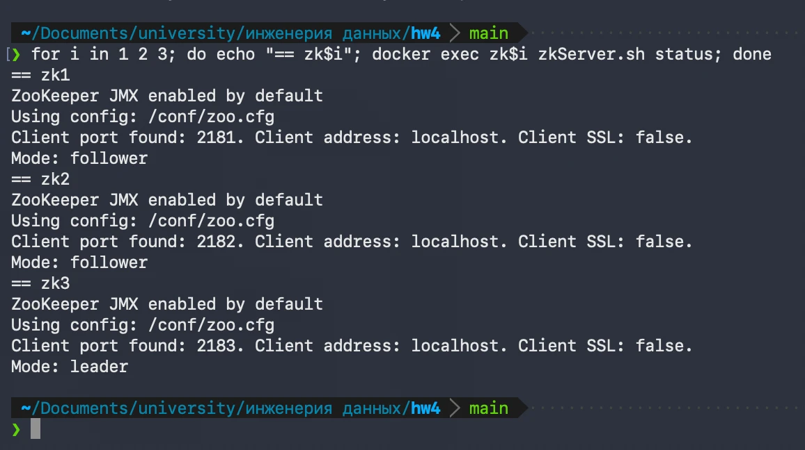 |
| Остановлен zk1: zk2 follower, zk3 leader | 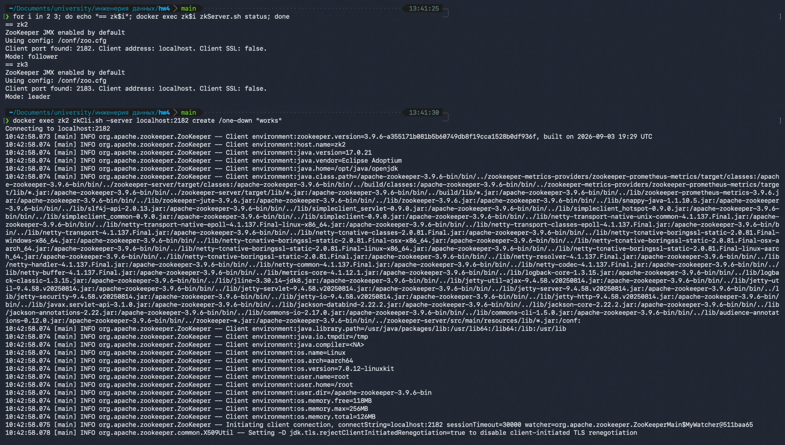 |
| Запись при 2 из 3: `Created /one-down` | 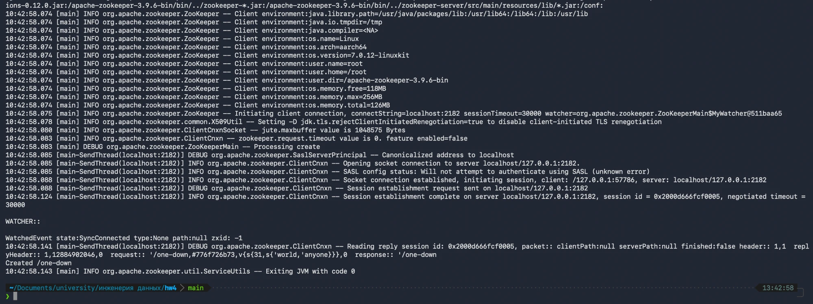 |
| Остановлен zk2: zk3 не обслуживает запросы, `ConnectionLoss`; после `docker start` роли вернулись, `/one-down` = `works` | 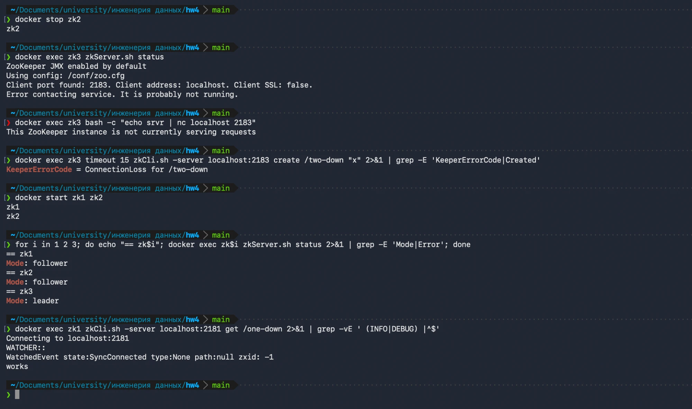 |
| Окно 2: `create -e`, `ephemeralOwner = 0x2000d76a5700000` | 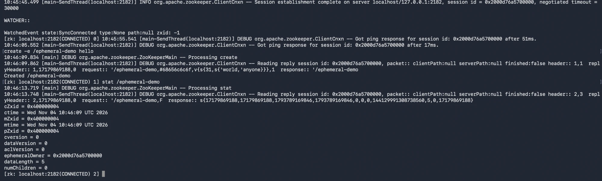 |
| Окно 1, пока окно 2 открыто: узел есть | 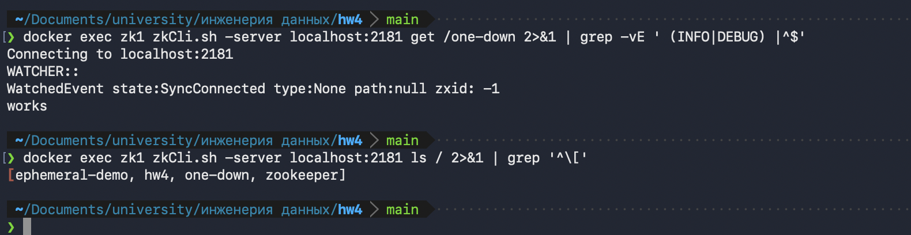 |
| Окно 1 после `quit` в окне 2: узла нет, `/one-down` (обычный узел) остался | 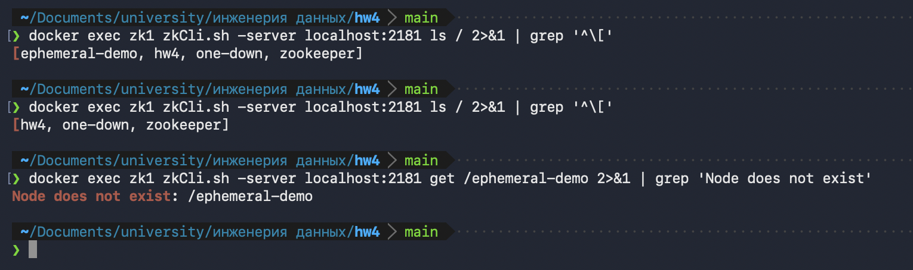 |

## Этап 3. Приостановка лидера без защиты (`logs/nofence_*.log`)

```
13:48:32.467 запущены координатор A (pid 81312, лидер) и B (pid 81315, запасной)
13:48:41.250 kill -STOP 81312: лидер A приостановлен посреди расчёта
13:48:52.953 B стал лидером через 11.63 s после приостановки A (тайм-аут сессии 10 s)
13:49:19.272 B завершил расчёт и опубликовал результат через 37.99 s после приостановки A
13:49:21.257 kill -CONT 81312: A возобновлён, был приостановлен 40.0 s
итог A: записал результат: /hw4/nofence/result -> версия 2 (без проверки эпохи)
итог B: записал результат: /hw4/nofence/result -> версия 1 (без проверки эпохи)
```

B стартовал с чекпоинта — первые 8 чанков пропущены: `чанк 1/25 уже в чекпоинте (A epoch=1) - пропуск`.
A после `SIGCONT` узнаёт, что сессия истекла (`LOST`), переподключается, досчитывает reduce и,
не проверяя эпоху, перезаписывает указатель: `dataVersion = 2`, `owner = A`, `epoch = 1`
(`outputs/zk_pointers.txt`). Две строки «записал результат» — результат записан дважды.

Скриншоты: журнал B — смена лидера, пропуск 8 чанков из чекпоинта, `СОВПАЛО с ДЗ 3`, версия 1;
журнал A — 8 чанков до `kill -STOP`; итог сценария — две строки «записал результат».

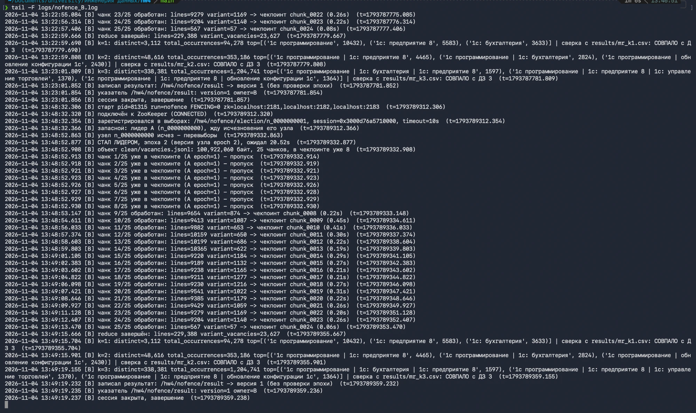
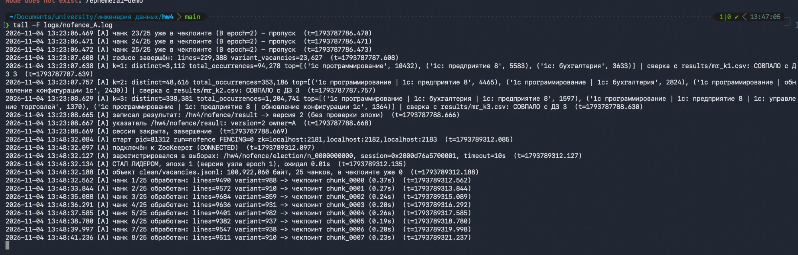
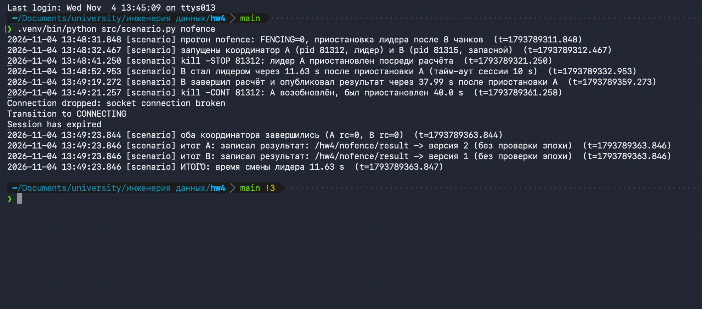

## Этап 4. Приостановка лидера с защитой по эпохе (`logs/fence_*.log`)

```
13:51:26.832 kill -STOP 81896: лидер A приостановлен посреди расчёта
13:51:38.976 B стал лидером через 12.04 s после приостановки A (тайм-аут сессии 10 s)
13:52:02.131 B завершил расчёт и опубликовал результат через 35.21 s после приостановки A
13:52:06.835 kill -CONT 81896: A возобновлён, был приостановлен 40.0 s
итог A: ЗАПИСЬ ОТКЛОНЕНА: BadVersionError - моя эпоха 1 (версия 1), текущая эпоха 2 (версия 2)
итог B: записал результат: /hw4/fence/result -> версия 1 (эпоха 2 проверена)
```

Указатель `/hw4/fence/result`: `dataVersion = 1`, `owner = B`, `epoch = 2` — результат один.
Для сравнения на том же скриншоте: `/hw4/nofence/result` — `dataVersion = 2`, `owner = A`.

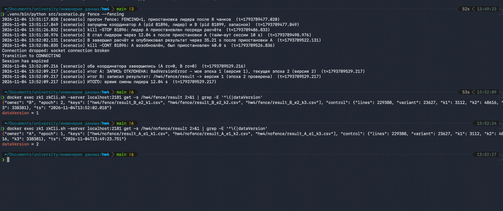

## Контрольные числа и сверка с ДЗ 3

Во всех четырёх запусках (A и B в обоих прогонах) после reduce:

| | ДЗ 3 (`logs/fault_test.log`, `verify.log`) | ДЗ 4 |
|---|---|---|
| строк | 229 388 | 229 388 |
| вакансий варианта | 23 627 | 23 627 |
| k=1 различных | 3 112 | 3 112 |
| k=2 различных (пары) | 48 616 | 48 616 |
| k=3 различных | 338 381 | 338 381 |
| топ пара | 1с программирование \| 1с: предприятие 8 — 4465 | то же |

Кроме чисел, координатор побайтово сравнивает свои CSV с `s3://hh-lake/results/mr_k{1,2,3}.csv`
из ДЗ 3: в каждом журнале три строки `сверка с results/mr_kN.csv: СОВПАЛО с ДЗ 3`.

## Время смены лидера

От `kill -STOP` до строки «СТАЛ ЛИДЕРОМ» у запасного: **11.63 с** (этап 3) и **12.04 с** (этап 4).
Это тайм-аут сессии 10 с плюс до ~2 с: сервер проверяет истечение сессий раз в `tickTime` (2 с),
после чего удаляет эфемерный узел A и отправляет B уведомление watch. Сами перевыборы занимают
миллисекунды (`узел n_0000000000 исчез - перевыборы` → `СТАЛ ЛИДЕРОМ` за ~10 мс).

## Ответы на вопросы

**Почему серверов три, а не два и не четыре?**
ZooKeeper принимает запись, только когда её подтвердило большинство ансамбля — строго больше
половины. Из трёх серверов большинство — два, поэтому один может упасть, а ансамбль продолжит работу:
это видно на этапе 2. Из двух серверов большинство — тоже два, так что падение любого из них
останавливает всё. Получается, что отказоустойчивость нулевая, а серверов, которые могут сломаться,
вдвое больше, чем у одиночного. Из четырёх серверов большинство — три, то есть переживается опять
только один отказ, как и у трёх. Четвёртый сервер ничего не добавляет, но каждая запись ждёт
на одно подтверждение больше и появляется ещё одна машина, которая может сломаться. Поэтому
размер ансамбля берут нечётным: 3 выдерживает 1 отказ, 5 — 2 отказа.
Нечётное число ещё и не даёт сети разделиться пополам «2 на 2», когда ни одна половина не может
выбрать лидера.

**Почему защиту по эпохе проверяет получатель записи, а не ZooKeeper?**
ZooKeeper не может остановить процесс, которого он не видит. Он лишь в какой-то момент решает,
что сессия A истекла, и назначает нового лидера. Но A про это не знает: на этапах 3–4 он стоял
на паузе, а после неё продолжил с того же места, уверенный, что всё ещё лидер. Если A проверит
«а лидер ли я?» и только потом сделает запись, между проверкой и записью снова может пройти пауза
(GC, своп, сеть), и проверка устареет. Надёжно только одно: в самой записи передать номер своей
эпохи, а сторона, которая эту запись принимает, атомарно сравнит его с текущей эпохой и откажет
устаревшему. Защитить можно только там, где запись реально происходит, а ZooKeeper в общем случае
этой записи не видит: результат может уходить в S3, базу или файл. В нашей работе получатель —
узел-указатель `result`, поэтому проверка сделана транзакцией `check(epoch) + set(result)`
в момент записи. Сам ZooKeeper здесь лишь хранилище, а не сторож: решение «старая эпоха —
отказать» выполняется только потому, что получатель записи его проверяет. Сами CSV в S3 при этом
пишут оба координатора (у них разные имена с эпохой), но публикация указателя остаётся одна.
